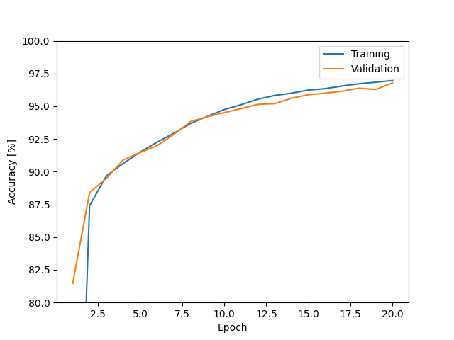
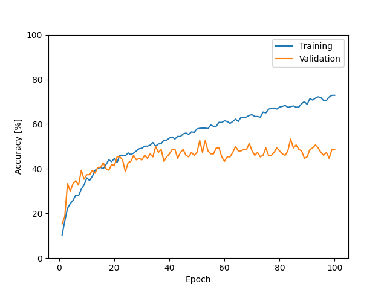
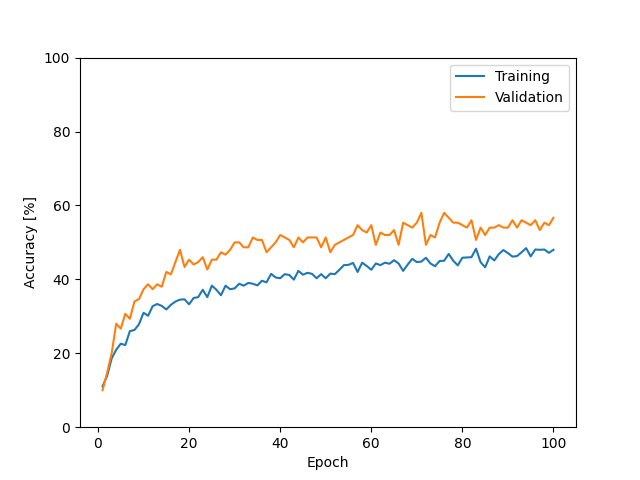
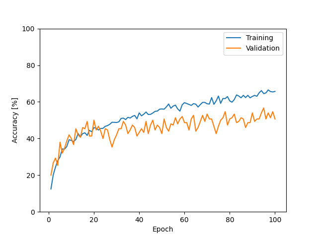
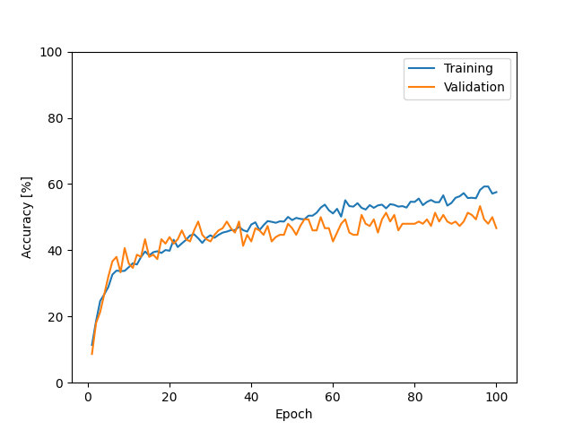

# Day3 画像認識

## 環境
| 環境 | 内容 | 使った演習 |
|---|---|---|
| Mac（CPU） | MacBook Air（Apple M1）、macOS 15.5、Python 3.12.16、PyTorch 2.9.1、torchvision 0.24.1 | 4.2.2〜4.2.4、コードの動作確認 |
| Google Colab（GPU） | Tesla T4 | 4.2.1、4.2.5〜4.2.8、4.2.9 の実験0〜C |
| Azure VM（GPU） | Tesla T4、torch 2.9.1+cu126、torchvision 0.24.1+cu126 | 4.2.9 の実験E と最後のテスト |

- Mac で GPU で学習したモデルを使うときは `-g -1`（CPU）で実行する。
- 依存パッケージ: リポジトリ直下の `requirements.txt` を参照

<!-- 演習を追加するときはこのブロックをコピーする
## 演習4.x.x タイトル
```sh
実行したコマンド
```
- 変更点: 変更したファイルと箇所（なければ「なし」）
- 結果: 数値や出力（図があればパスも）
-->

## 演習4.2.1 MLPでMNIST学習
```sh
python train_mnist_mlp.py -g 0 -o result/mlp
```
- 変更点: なし
- 設定: デフォルト（epoch 20, unit 1000, batchsize 100）
- 実行環境: Google Colab GPU（Tesla T4）
- 結果: 20エポック目の精度（グラフからの読み取り値）と学習時間（`time` の real）

| train | validation | かかった時間 |
|---|---|---|
| 約 95.0% | 約 94.5% | 2分51.7秒 |


## 演習4.2.2 手書き数字画像の作成
```sh
なし（ブラウザの描画ページでマウスで作成）
```
- 変更点: なし
- 結果: 黒地に白文字で数字の 8 を描いた画像（280×280、RGBA。透明部分なし）


## 演習4.2.3 手書き数字の認識
```sh
python test_mnist_mlp.py -g -1 -m result/mlp/model_20 -i my_digit.png
```
- 変更点: test_mnist_mlp.py の `torch.load` に `map_location='cpu'` を追加（GPU で学習したモデルを Mac の CPU で読み込むため）
- 実行環境: Mac の CPU（モデルは Colab の GPU で学習した20エポック目のもの）
- 注意: `result/mlp/model_20` は git 管理外なので、演習4.2.1 の手順で作る。乱数シードを固定していないため、学習し直すと予測が変わる可能性がある
- 結果: 

| 入力 | 正解 | 予測 | 判定 |
|---|---|---|---|
| my_digit.png | 8 | 3 | 誤り |

## 演習4.2.4 予測の上位3つの表示
```sh
python test_mnist_mlp.py -g -1 -m result/mlp/model_20 -i my_digit.png --topk 3
```
- 変更点: test_mnist_mlp.py（`--topk 3` で次を切り替える。既定の `--topk 1` は演習4.2.3 と同じ表示）
  - 予測: `torch.topk` で確信度が高い順に上位 `args.topk` 個の数字を取り出して表示する
- 実行環境: Mac の CPU（モデルは Colab の GPU で学習した20エポック目のもの）
- 結果: 

| 入力 | 正解 | 1位 | 2位 | 3位 |
|---|---|---|---|---|
| my_digit.png | 8 | 3 | 2 | 5 |

## 演習4.2.5 中間ノード数の変更
```sh
python train_mnist_mlp.py -g 0 -u 3 -f 100 -o result/mlp_u3
python train_mnist_mlp.py -g 0 -u 10000 -f 100 -o result/mlp_u10000
```
- 変更点: train_mnist_mlp.py（学習終了時に最終精度を表示する1行を追加。学習の動作は変わらない）
- 設定: epoch 20, batchsize 100, unit のみ変更（`-f 100` は途中のモデルを保存しない指定）
- 実行環境: Google Colab GPU（T4）
- 結果: 20エポック目の精度と学習時間（`time` の real）

| 中間ノード数 | train | validation | かかった時間 |
|---|---|---|---|
| 3 | 68.36% | 68.37% | 2分49.4秒 |
| 10000 | 96.29% | 94.97% | 7分23.7秒 |

- 比較: 中間ノード数 10000 は 3 より validation の精度が 26.60 ポイント高く、学習時間は約 2.6 倍だった。

## 演習4.2.6 CNN実装
```sh
python train_mnist_cnn.py -g 0 -o result/cnn
```
- 変更点:
  - network.py の `MnistCNN.__init__`（66-67行目）: 畳み込み層2つを実装
    - `conv1`: `nn.Conv2d(1, 5, 5, stride=2, padding=2)`（1 × 28 × 28 → 5 × 14 × 14）
    - `conv2`: `nn.Conv2d(5, 10, 5, stride=2, padding=2)`（5 × 14 × 14 → 10 × 7 × 7）
    - stride と padding は、カーネルサイズ 5 で縦横が半分になるよう、どちらの層も stride 2、padding 2 を選んだ
  - train_mnist_cnn.py（35-36行目）: `net = MLP(...)` をコメントアウトし、`net = MnistCNN(10)` に切り替え
  - train_mnist_cnn.py: 学習終了時に最終精度を表示する1行を追加
- 設定: デフォルト（epoch 20, batchsize 100）
- 実行環境: Google Colab GPU（Tesla T4）
- 結果: 20エポック目の精度と学習時間（`time` の real）。演習4.2.1 の MLP の精度はグラフからの読み取り値

| モデル | train | validation | かかった時間 |
|---|---|---|---|
| MLP（演習4.2.1、unit 1000） | 約 95.0% | 約 94.5% | 2分51.7秒 |
| CNN（演習4.2.6） | 96.96% | 96.80% | 2分54.4秒 |

- 比較: CNN は MLP より validation の精度が約 2.3 ポイント高く、学習時間は約 2.6 秒長かった。



## 演習4.2.7 CIFAR-10の学習
```sh
python train_cifar10.py -g 0 -o result/cifar10 -d data/mini_cifar
```
- 変更点: dataset.py の `MyCifarDataset` を穴埋め
  - `classes`: クラス名（フォルダ名）から 0〜9 の番号への辞書
  - `img_path_list`: `glob` で `cls_dir` の中の png のパスを取得
  - `cls_label`: `classes[cls]` でクラスの番号を取得
  - `__getitem__`: `self.all_data[idx]` からパスとラベルを取り出す
- 設定: デフォルト（epoch 20, batchsize 100）、データは mini_cifar（学習用 1500 枚を学習:検証 = 9:1 に分割）
- 実行環境: Google Colab GPU（Tesla T4）
- 結果: 20エポック目の精度（グラフからの読み取り値）

| train | validation |
|---|---|
| 約 12% | 約 8% |


## 演習4.2.8 CIFAR-10のテスト
```sh
python test_cifar10.py -g 0 -b 64 -m result/cifar10/model_18 -d data/mini_cifar
```
- 変更点: なし
- 設定: `-b 64`（テストは 201 枚なので、バッチサイズ 100 だと最後のバッチが1枚になり、`.squeeze()` のため `IndexError` になる。精度は1枚ずつ数えるのでバッチサイズの影響を受けない）
- 使用モデル: `model_18`（演習4.2.7 のグラフで validation が最も高いエポックのうち、最も後のもの。グラフからの読み取り）
- 実行環境: Google Colab GPU（Tesla T4）
- 結果: テスト精度 12.438%

| クラス | 精度 |
|---|---|
| airplane | 15% |
| automobile | 5% |
| bird | 0% |
| cat | 0% |
| deer | 10% |
| dog | 85% |
| frog | 0% |
| horse | 0% |
| ship | 9% |
| truck | 0% |

## 演習4.2.9 CIFAR-10 の精度向上（発展課題）

### 1. 目的
CIFAR-10（mini_cifar）を分類する CNN の精度を上げることを目的とした。学習曲線から精度が低い原因を診断し、その原因に対応する変更を1つずつ加えて効果を確かめた。

### 2. 実験の方法（全実験に共通する条件）
- **データ**: 学習 1,350 枚・検証 150 枚（mini_cifar の学習用 1,500 枚を 9:1 に分割）、テスト 201 枚。
- **比べ方**: 乱数の種を固定（seed 0）して、学習と検証の分け方を毎回同じにした。1回の実験で変えるのは1か所だけとした。
- **評価に使った値**: 図3、図4 に見られるように、検証データが 150 枚と少ないため、検証精度はエポックごとに大きく上下する。そのため、1つのエポックの値ではなく、最後の20エポックの検証精度の平均で比べた。
- **実行環境**: 実験0〜C は Google Colab、実験E と最後のテストは Azure VM で実行した（どちらも Tesla T4）。実験F を Azure VM で再実行したところ、最後の20エポックの検証精度の平均は 52.57% で、Colab の 54.47% と近い値（差 1.90 ポイント）だった。この差は隣り合うエポックの変動より小さいので、環境の違いが精度の比較に与える影響は小さいと判断した。学習時間は環境によって変わるので比べない。

### 3. 実験の流れと結果

| 実験 | 変えたこと | パラメータ数 | 最終エポックの学習精度 | 検証精度の最大値（何エポック目） | 最後の20エポックの検証精度の平均 | 学習時間 | 実行環境 |
|---|---|---|---|---|---|---|---|
| 0 | 変更なし（ベースライン） | 6,882 | 15.11% | 13.33%（2〜4エポック目） | — | 19.8秒 | Colab（Tesla T4） |
| A | エポック数 20→100 | 6,882 | 38.30% | 46.67%（100エポック目） | — | 1分15.0秒 | Colab（Tesla T4） |
| B | 最適化手法 SGD→Adam（lr=0.001）※以降はBを基準とする | 6,882 | 44.59% | 42.67%（16エポック目） | — | 19.9秒 | Colab（Tesla T4） |
| B2 | Bからエポック数 20→100 | 6,882 | 72.89% | 53.33%（84エポック目） | 48.07%（81〜100エポック目） | 1分13.9秒 | Colab（Tesla T4） |
| F | B2にデータ拡張（左右反転 + RandomCrop(32, padding=4)）を追加 | 6,882 | 48.00% | 58.00%（71, 76エポック目） | 54.47%（81〜100エポック目） | 1分23.7秒 | Colab（Tesla T4） |
| C | Fからチャンネル数を増やす（conv1 6→32、conv2 16→64） | 69,706 | 65.70% | 56.67%（95エポック目） | 51.23%（81〜100エポック目） | 1分28.7秒 | Colab（Tesla T4） |
| E | Cの全結合層の直前にドロップアウト（p=0.5）を追加 | 69,706 | 57.56% | 53.33%（96エポック目） | 49.20%（81〜100エポック目） | 1分3.2秒 | Azure VM（Tesla T4） |

※ 学習時間は実行環境によって変わるため、実行環境が異なる実験どうしでは比較しない。

#### 段階1: 学習が進まない（実験0 → A, B）
ベースラインでは検証精度が 10.67〜13.33% で当てずっぽう（10%）と同程度だった。loss もほとんど下がらなかった。ログに表示される loss は、1エポックの 14 個のミニバッチそれぞれの loss（画像1枚あたりの交差エントロピーの平均。バッチ内の画像の枚数で割った平均なので、バッチの大きさによらない）を足し合わせた値である。モデルが何も学習しておらず、10 クラスすべてに同じ確率 1/10 をつけると、画像1枚あたりの loss は −log(1/10) ≈ 2.30 になり、14 個足すと約 32.2 になる。ベースラインの loss は 1 エポック目 32.250、20 エポック目 32.053 で、この「何も学習していない状態」の値とほぼ同じままだった。学習データが少なく、1エポックの更新回数が 14 回しかないうえ、学習率も小さいためと考えた。エポック数を増やす（A）と、最適化手法を Adam に変える（B）の2つを試した。B は 20 エポックで A の 100 エポックと同程度の精度（検証精度の最大値 B 42.67%、A 46.67%）に達したので、以降は B を基準とした。

図1 実験0の学習曲線


#### 段階2: 過学習（実験B2 → F）
B を 100 エポック学習させると（B2）、学習精度は 73% まで上がったが、検証精度は 48% 前後で止まった。過学習と判断し、学習データにだけデータ拡張（左右反転とずらし）をかけた（F）。検証精度の平均は 48.1% → 54.5% に上がった。学習精度は下がったが、変形した画像で測っているためで、想定どおりである。

図2 実験B2の学習曲線



図3 実験Fの学習曲線



#### 段階3: 表現力を上げる試み（実験C → E）
F の学習精度 48% は、変形した画像で測っているために低く出ている分もあるが、ネットワークが小さすぎて見分けきれていない（表現力不足の）可能性もある。どちらなのかを確かめるため、チャンネル数を増やした（C、パラメータ約10倍）。C も F と同じく変形した画像で学習精度を測っているので、2つは同じ条件で比べられる。学習精度は 48% から 66% に上がったので、小さいネットワークでは当てはまりきっていなかったと言える。しかし検証精度は上がらず、学習精度が検証精度を約 14 ポイント上回ったので、過学習が戻ったと判断した。そこでドロップアウトを加えた（E）。差は約 8 ポイントに縮んだが、検証精度は F に届かなかった。

図4 実験Cの学習曲線



図5 実験Eの学習曲線



#### 段階4: 最終テスト
検証精度が一番高かった F を最終モデルとし、Azure VM で再実行した F のうち、検証精度が最大のエポック（86 エポック目）のモデルでテストした。比較のため、ベースライン（実験0）も Azure VM で再実行し、同じ選び方（同点のときは最も後のエポック。演習4.2.8 と同じ）でテストした。テストデータは 201 枚である。

Azure VM での再実行の結果

| 実験 | パラメータ数 | 最終エポックの学習精度 | 検証精度の最大値（何エポック目） | 最後の20エポックの検証精度の平均 | 学習時間 |
|---|---|---|---|---|---|
| 0（Azure） | 6,882 | 14.89% | 13.33%（1〜4エポック目） | — | 32.3秒 |
| F（Azure） | 6,882 | 45.33% | 57.33%（86エポック目） | 52.57%（81〜100エポック目） | 38.6秒 |

| 実験 | 使用モデル | テスト精度 |
|---|---|---|
| 0（ベースライン） | `model_4`（検証精度 13.33%） | 10.448% |
| F（Adam、100エポック、データ拡張） | `model_86`（検証精度 57.33%） | 47.761% |

| クラス | 実験0 | 実験F |
|---|---|---|
| airplane | 75% | 65% |
| automobile | 0% | 55% |
| bird | 5% | 25% |
| cat | 0% | 45% |
| deer | 0% | 25% |
| dog | 15% | 30% |
| frog | 0% | 45% |
| horse | 10% | 70% |
| ship | 0% | 57% |
| truck | 0% | 60% |

### 4. 考察

**効いた変更**: 検証精度を最も上げたのはデータ拡張だった（B2 → F で検証精度の平均 48.1% → 54.5%）。B2 では学習精度 73% に対して検証精度 48% と、学習データ 1,350 枚を覚えてしまう過学習が起きていた。データ拡張で学習データの種類を実質的に増やしたことで、これが抑えられたと考えられる。一方、ネットワークを大きくする（C）と学習精度は 48% から 66% に上がったが、検証精度は上がらず、学習精度が検証精度を約 14 ポイント上回る過学習が戻った。これは、モデルを大きくするとバイアス（当てはまりの悪さ）は減るが、分散（学習データへの合わせすぎ）が増えるという、バイアスと分散のトレードオフが現れたものと考えられる。ドロップアウト（E）は学習精度と検証精度の差を約 8 ポイントに縮めたが、検証精度は F に届かなかった。以上のように、ネットワークを大きくして学習データへの当てはまりを良くしても検証精度は上がらず、データ拡張で学習データの種類を増やすと検証精度が上がった。このことから、今回試した範囲では、ネットワークの大きさよりも学習データの少なさのほうが、検証精度を伸び悩ませていたと考えられる。

**テスト精度が検証精度より低い理由**: F のテスト精度（47.8%）は、モデル選択に使った検証精度の最大値（57.3%）より約 10 ポイント低かった。100 エポックの中から検証精度が最大のエポックを選ぶと、偶然よく当たったエポックを選びやすく、その検証精度は高めに出る。実際、最後の20エポックの検証精度の平均は 52.6% で、最大値より低い。テストデータはモデルの選択に使っていないので、テスト精度のほうが実力に近い値と考えられる。

**限界**: 検証データは 150 枚しかなく、1 枚当たるかどうかで精度が 0.67 ポイント動く。そのため、モデルの実力に差がなくても、正解・不正解の境目にある数枚が入れ替わるだけで数ポイント変わりうる。実際、設定も乱数の種も同じ実験 F を Colab と Azure VM で実行すると、検証精度の平均が 1.9 ポイント（約 3 枚分）異なった。F と C の差（約 3 ポイント）もこれと同程度であり、はっきりした差とは言えない。テストデータ（201 枚）も同様である。

### 付録: 実行コマンドとコードの変更点

#### 実行コマンド
- `-d /content/mini_cifar` は Colab のパス（Drive の `data/mini_cifar` を Colab のローカルディスク `/content` にコピーして使用）。手元（Mac）や Azure VM では、`day3_cv` の中で `-d data/mini_cifar` を使う。
- 全実験で `--seed 0`。`-f 100`, `-f 200` は途中のモデルを保存しない指定、`-f 1` は毎エポックのモデルを保存する指定。

| 実験 | 変えたこと | 実行環境 | コマンド |
|---|---|---|---|
| 0 | 変更なし（ベースライン） | Colab | `python train_cifar10.py -g 0 -o result/cifar10_exp0 -d /content/mini_cifar --seed 0 -f 100` |
| A | エポック数 20→100 | Colab | `python train_cifar10.py -g 0 -e 100 -o result/cifar10_expA -d /content/mini_cifar --seed 0 -f 200` |
| B | 最適化手法 SGD→Adam | Colab | `python train_cifar10.py -g 0 --optimizer adam -o result/cifar10_expB -d /content/mini_cifar --seed 0 -f 100` |
| B2 | Bからエポック数 20→100 | Colab | `python train_cifar10.py -g 0 -e 100 --optimizer adam -o result/cifar10_expB2 -d /content/mini_cifar --seed 0 -f 200` |
| F | B2にデータ拡張を追加 | Colab | `python train_cifar10.py -g 0 -e 100 --optimizer adam --augment -o result/cifar10_expF -d /content/mini_cifar --seed 0 -f 200` |
| C | Fからチャンネル数を増やす | Colab | `python train_cifar10.py -g 0 -e 100 --optimizer adam --augment --ch1 32 --ch2 64 -o result/cifar10_expC -d /content/mini_cifar --seed 0 -f 200` |
| E | Cにドロップアウトを追加 | Azure VM | `python train_cifar10.py -g 0 -e 100 --optimizer adam --augment --ch1 32 --ch2 64 --dropout 0.5 -o result/cifar10_expE -d data/mini_cifar --seed 0 -f 200` |
| 0（Azure） | 実験0 を再実行（毎エポック保存） | Azure VM | `python train_cifar10.py -g 0 -o result/cifar10_exp0_azure -d data/mini_cifar --seed 0 -f 1` |
| F（Azure） | 実験F を再実行（毎エポック保存） | Azure VM | `python train_cifar10.py -g 0 -e 100 --optimizer adam --augment -o result/cifar10_expF_azure -d data/mini_cifar --seed 0 -f 1` |
| テスト 0 | 実験0（Azure）の4エポック目のモデル | Azure VM | `python test_cifar10.py -g 0 -b 64 -m result/cifar10_exp0_azure/model_4 -d data/mini_cifar` |
| テスト F | 実験F（Azure）の86エポック目のモデル | Azure VM | `python test_cifar10.py -g 0 -b 64 -m result/cifar10_expF_azure/model_86 -d data/mini_cifar` |

- 設定: epoch 20（実験A, B2, F, C, E は 100）, batchsize 100。学習時間は `time` の real。
- テストの `-b 64` は、テスト 201 枚をバッチサイズ 100 で分けると最後のバッチが1枚になり、`.squeeze()` のため `IndexError` になるのを避けるため（演習4.2.8 と同じ）。

#### コードの変更点
引数はすべて、指定しなければ配布時と同じ動作になる。

- **`--seed`**（train_cifar10.py の `main()`）: 指定したときだけ `torch.manual_seed` で乱数の種を固定し、cuDNN を決定的な設定にする。あわせて、エポックごとの学習精度と検証精度を表示するようにした。
- **`--optimizer`**（train_cifar10.py の `main()`）: `adam` のとき `optim.Adam(net.parameters(), lr=0.001)`、それ以外は配布時の `optim.SGD(net.parameters(), lr=0.001, momentum=0.9)`。
- **`--augment`**（train_cifar10.py の `main()`、`random_split` の直後）: 学習用の番号（`trainset.indices`）だけを、拡張ありの `transform` を持つ複製データセットから取り出す。`valset` は元の拡張なしの `trainvalset` のままなので、検証データには拡張がかからない。

  ```python
  if args.augment:
      augmentset = copy.copy(trainvalset)
      augmentset.transform = transforms.Compose([
          transforms.RandomHorizontalFlip(),
          transforms.RandomCrop(32, padding=4),
          transforms.ToTensor()])
      trainset = torch.utils.data.Subset(augmentset, trainset.indices)
  ```

- **`--ch1`, `--ch2`**（network.py の `CifarCNN.__init__` と `CifarCNN.forward`。train_cifar10.py と test_cifar10.py の `main()` で `CifarCNN(10, args.ch1, args.ch2, args.dropout)` として渡す）: conv1, conv2 の出力チャンネル数を変え、全結合層の入力も `ch2 × 5 × 5` に合わせる。

  ```python
  # CifarCNN.__init__
  self.ch2 = ch2
  self.conv1 = nn.Conv2d(3, ch1, 5, stride=1)
  self.conv2 = nn.Conv2d(ch1, ch2, 5, stride=1)
  self.fc = nn.Linear(ch2 * 5 * 5, n_out)
  # CifarCNN.forward
  h = h.view(-1, self.ch2 * 5 * 5)
  ```

- **`--dropout`**（network.py の `CifarCNN.__init__` と `CifarCNN.forward`、train_cifar10.py と test_cifar10.py の `main()`）: 全結合層の直前にドロップアウトを入れる。検証とテストの前に `net.eval()` でドロップアウトを無効にし、検証の後に `net.train()` で学習モードに戻す。

  ```python
  # CifarCNN.__init__
  self.dropout = nn.Dropout(dropout) if dropout > 0 else nn.Identity()
  # CifarCNN.forward
  h = h.view(-1, self.ch2 * 5 * 5)
  h = self.dropout(h)
  y = self.fc(h)
  # train_cifar10.py の main()（検証の前後）
  net.eval()
  with torch.no_grad():
      ...  # 検証
  net.train()
  ```
