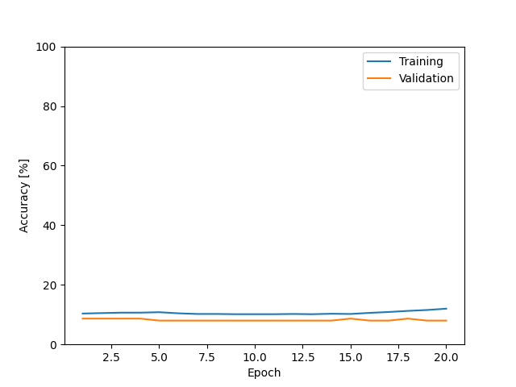
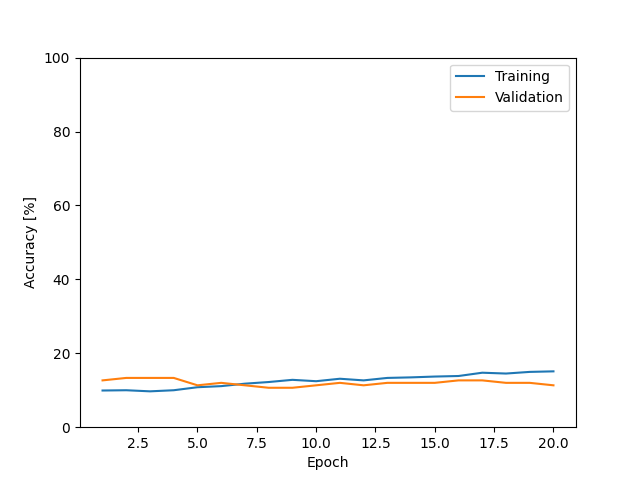
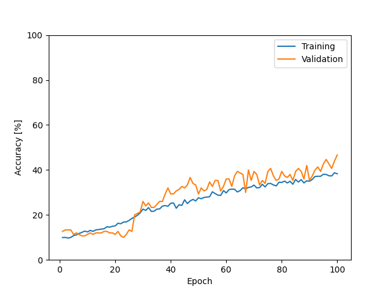

# Day3 画像認識

## 環境
（ここに実行環境）

<!-- 演習を追加するときはこのブロックをコピーする
## 演習4.x.x タイトル
```sh
実行したコマンド
```
- 変更点: 変更したファイルと箇所（なければ「なし」）
- 結果: 数値や出力（図があればパスも）
-->

## 演習4.2.1 MLPでMNIST学習
```sh
python train_mnist_mlp.py -g 0 -o result/mlp
```
- 変更点: なし
- 設定: デフォルト（epoch 20, unit 1000, batchsize 100）
- 実行環境: Google Colab GPU（Tesla T4）
- 結果: 20エポック目の精度（グラフからの読み取り値）と学習時間（`time` の real）

| train | validation | かかった時間 |
|---|---|---|
| 約 95.0% | 約 94.5% | 2分51.7秒 |


## 演習4.2.2 手書き数字画像の作成
```sh
なし（ブラウザの描画ページでマウスで作成）
```
- 変更点: なし
- 結果: 黒地に白文字で数字の 8 を描いた画像（280×280、RGBA。透明部分なし）


## 演習4.2.3 手書き数字の認識
```sh
python test_mnist_mlp.py -g -1 -m result/mlp/model_20 -i my_digit.png
```
- 変更点: test_mnist_mlp.py の `torch.load` に `map_location='cpu'` を追加（GPU で学習したモデルを Mac の CPU で読み込むため）
- 実行環境: Mac の CPU（モデルは Colab の GPU で学習した20エポック目のもの）
- 注意: `result/mlp/model_20` は git 管理外なので、演習4.2.1 の手順で作る。乱数シードを固定していないため、学習し直すと予測が変わる可能性がある
- 結果: 

| 入力 | 正解 | 予測 | 判定 |
|---|---|---|---|
| my_digit.png | 8 | 3 | 誤り |

## 演習4.2.4 予測の上位3つの表示
```sh
python test_mnist_mlp.py -g -1 -m result/mlp/model_20 -i my_digit.png --topk 3
```
- 変更点: test_mnist_mlp.py（`--topk 3` で次を切り替える。既定の `--topk 1` は演習4.2.3 と同じ表示）
  - 予測: `torch.topk` で確信度が高い順に上位 `args.topk` 個の数字を取り出して表示する
- 実行環境: Mac の CPU（モデルは Colab の GPU で学習した20エポック目のもの）
- 結果: 

| 入力 | 正解 | 1位 | 2位 | 3位 |
|---|---|---|---|---|
| my_digit.png | 8 | 3 | 2 | 5 |

## 演習4.2.5 中間ノード数の変更
```sh
python train_mnist_mlp.py -g 0 -u 3 -f 100 -o result/mlp_u3
python train_mnist_mlp.py -g 0 -u 10000 -f 100 -o result/mlp_u10000
```
- 変更点: train_mnist_mlp.py（学習終了時に最終精度を表示する1行を追加。学習の動作は変わらない）
- 設定: epoch 20, batchsize 100, unit のみ変更（`-f 100` は途中のモデルを保存しない指定）
- 実行環境: Google Colab GPU（T4）
- 結果: 20エポック目の精度と学習時間（`time` の real）

| 中間ノード数 | train | validation | かかった時間 |
|---|---|---|---|
| 3 | 68.36% | 68.37% | 2分49.4秒 |
| 10000 | 96.29% | 94.97% | 7分23.7秒 |

- 比較: 中間ノード数 10000 は 3 より validation の精度が 26.60 ポイント高く、学習時間は約 2.6 倍だった。

## 演習4.2.6 CNN実装
```sh
python train_mnist_cnn.py -g 0 -o result/cnn
```
- 変更点:
  - network.py の `MnistCNN.__init__`（66-67行目）: 畳み込み層2つを実装
    - `conv1`: `nn.Conv2d(1, 5, 5, stride=2, padding=2)`（1 × 28 × 28 → 5 × 14 × 14）
    - `conv2`: `nn.Conv2d(5, 10, 5, stride=2, padding=2)`（5 × 14 × 14 → 10 × 7 × 7）
    - stride と padding は、カーネルサイズ 5 で縦横が半分になるよう、どちらの層も stride 2、padding 2 を選んだ
  - train_mnist_cnn.py（35-36行目）: `net = MLP(...)` をコメントアウトし、`net = MnistCNN(10)` に切り替え
  - train_mnist_cnn.py: 学習終了時に最終精度を表示する1行を追加
- 設定: デフォルト（epoch 20, batchsize 100）
- 実行環境: Google Colab GPU（Tesla T4）
- 結果: 20エポック目の精度と学習時間（`time` の real）。演習4.2.1 の MLP の精度はグラフからの読み取り値

| モデル | train | validation | かかった時間 |
|---|---|---|---|
| MLP（演習4.2.1、unit 1000） | 約 95.0% | 約 94.5% | 2分51.7秒 |
| CNN（演習4.2.6） | 96.96% | 96.80% | 2分54.4秒 |

- 比較: CNN は MLP より validation の精度が約 2.3 ポイント高く、学習時間は約 2.6 秒長かった。


## 演習4.2.7 CIFAR-10の学習
```sh
python train_cifar10.py -g 0 -o result/cifar10 -d data/mini_cifar
```
- 変更点: dataset.py の `MyCifarDataset` を穴埋め
  - `classes`: クラス名（フォルダ名）から 0〜9 の番号への辞書
  - `img_path_list`: `glob` で `cls_dir` の中の png のパスを取得
  - `cls_label`: `classes[cls]` でクラスの番号を取得
  - `__getitem__`: `self.all_data[idx]` からパスとラベルを取り出す
- 設定: デフォルト（epoch 20, batchsize 100）、データは mini_cifar（学習用 1500 枚を学習:検証 = 9:1 に分割）
- 実行環境: Google Colab GPU（Tesla T4）
- 結果: 20エポック目の精度（グラフからの読み取り値）

| train | validation |
|---|---|
| 約 12% | 約 8% |



## 演習4.2.8 CIFAR-10のテスト
```sh
python test_cifar10.py -g 0 -b 64 -m result/cifar10/model_18 -d data/mini_cifar
```
- 変更点: なし
- 設定: `-b 64`（テストは 201 枚なので、バッチサイズ 100 だと最後のバッチが1枚になり、`.squeeze()` のため `IndexError` になる。精度は1枚ずつ数えるのでバッチサイズの影響を受けない）
- 使用モデル: `model_18`（演習4.2.7 のグラフで validation が最も高いエポックのうち、最も後のもの。グラフからの読み取り）
- 実行環境: Google Colab GPU（Tesla T4）
- 結果: テスト精度 12.438%

| クラス | 精度 |
|---|---|
| airplane | 15% |
| automobile | 5% |
| bird | 0% |
| cat | 0% |
| deer | 10% |
| dog | 85% |
| frog | 0% |
| horse | 0% |
| ship | 9% |
| truck | 0% |

## 演習4.2.9 CIFAR-10 の精度向上（発展課題）
```sh
python train_cifar10.py -g 0 -o result/cifar10_exp0 -d /content/mini_cifar --seed 0 -f 100
python train_cifar10.py -g 0 -e 100 -o result/cifar10_expA -d /content/mini_cifar --seed 0 -f 200
```
- 変更点: train_cifar10.py に `--seed`（既定は固定しない）とエポックごとの精度表示を追加（学習の動作は変わらない）
- 設定: epoch 20（実験A は 100）, batchsize 100, seed 0, データは mini_cifar（Colab のローカルディスクにコピーして使用）。`-f` は途中のモデルを保存しない指定
- 実行環境: Google Colab GPU（Tesla T4）
- 結果: 学習時間は `time` の real

| 実験 | 変えたこと | パラメータ数 | 最終エポックの学習精度 | 検証精度の最大値（何エポック目） | 学習時間 |
|---|---|---|---|---|---|
| 0 | 変更なし（ベースライン） | 6,882 | 15.11% | 13.33%（2〜4エポック目） | 19.8秒 |
| A | エポック数 20→100 | 6,882 | 38.30% | 46.67%（100エポック目） | 1分15.0秒 |

実験0



実験A



## 演習4.3.x 深層特徴データベースの作成
```sh
python create_db.py -g 0 -d データセットのパス
```
- 変更点: 
- 結果: 

## 演習4.3.x 深層特徴検索
```sh
python search.py -g 0 -i 入力画像のパス -f result/feature.pt -p result/path.pt -k 5
```
- 変更点: 
- 結果: 
