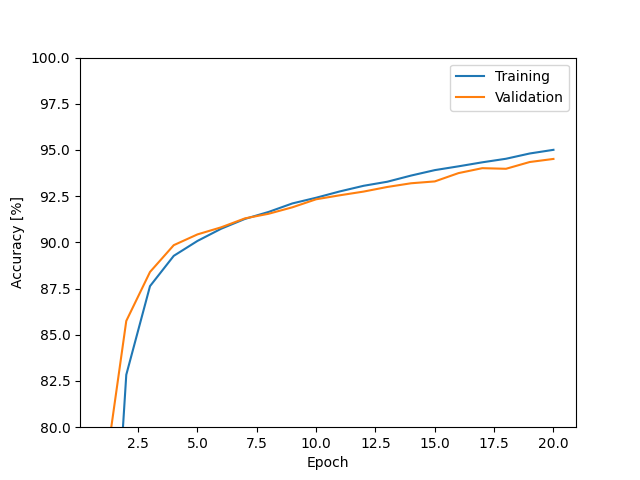

# Day3 画像認識

## 環境
（ここに実行環境）

<!-- 演習を追加するときはこのブロックをコピーする
## 演習4.x.x タイトル
```sh
実行したコマンド
```
- 変更点: 変更したファイルと箇所（なければ「なし」）
- 結果: 数値や出力（図があればパスも）
-->

## 演習4.2.1 MLPでMNIST学習
```sh
python train_mnist_mlp.py -g 0 -o result/mlp
```
- 変更点: なし
- 設定: デフォルト（epoch 20, unit 1000, batchsize 100）
- 実行環境: Google Colab GPU（Tesla T4）
- 結果: 20エポック目の精度（グラフからの読み取り値）と学習時間（`time` の real）

| train | validation | かかった時間 |
|---|---|---|
| 約 95.0% | 約 94.5% | 2分51.7秒 |



## 演習4.2.2 手書き数字画像の作成
```sh
なし（ブラウザの描画ページでマウスで作成）
```
- 変更点: なし
- 結果: 黒地に白文字で数字の 8 を描いた画像（280×280、RGBA。透明部分なし）


## 演習4.2.3 手書き数字の認識
```sh
python test_mnist_mlp.py -g -1 -m result/mlp/model_20 -i my_digit.png
```
- 変更点: test_mnist_mlp.py の `torch.load` に `map_location='cpu'` を追加（GPU で学習したモデルを Mac の CPU で読み込むため）
- 実行環境: Mac の CPU（モデルは Colab の GPU で学習した20エポック目のもの）
- 注意: `result/mlp/model_20` は git 管理外なので、演習4.2.1 の手順で作る。乱数シードを固定していないため、学習し直すと予測が変わる可能性がある
- 結果: 

| 入力 | 正解 | 予測 | 判定 |
|---|---|---|---|
| my_digit.png | 8 | 3 | 誤り |

## 演習4.2.6 CNN実装
```sh
python train_mnist_cnn.py -g 0 -o result/cnn
```
- 変更点: 
- 結果: 検証精度 xx% (図のパス)

## 演習4.x.x CIFAR-10の学習
```sh
python train_cifar10.py -g 0 -o result/cifar10 -d data/mini_cifar
```
- 変更点: 
- 結果: 検証精度 xx% (図のパス)

## 演習4.x.x CIFAR-10のテスト
```sh
python test_cifar10.py -g 0 -m result/cifar10/model_final -d data/mini_cifar
```
- 変更点: 
- 結果: テスト精度 xx%

## 演習4.3.x 深層特徴データベースの作成
```sh
python create_db.py -g 0 -d データセットのパス
```
- 変更点: 
- 結果: 

## 演習4.3.x 深層特徴検索
```sh
python search.py -g 0 -i 入力画像のパス -f result/feature.pt -p result/path.pt -k 5
```
- 変更点: 
- 結果: 
