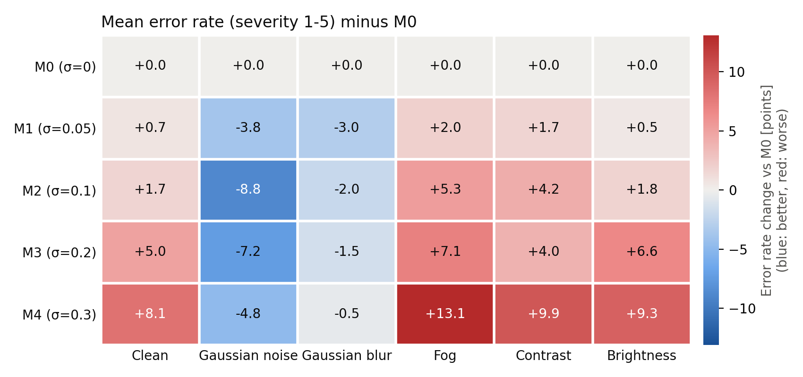
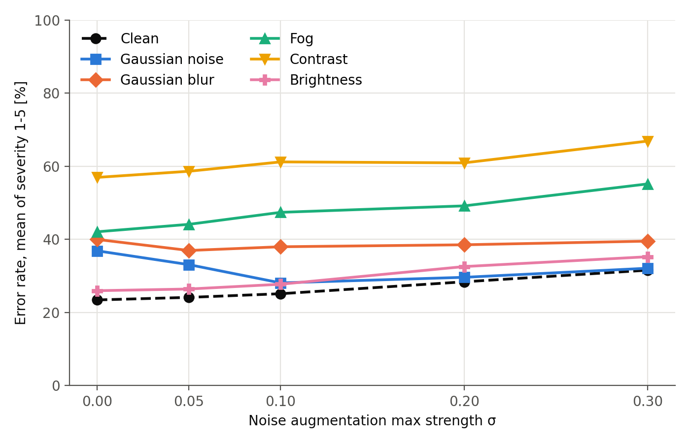
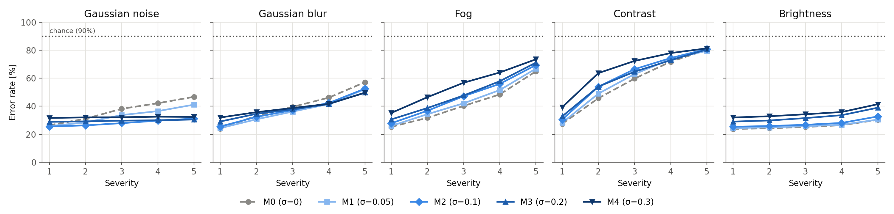
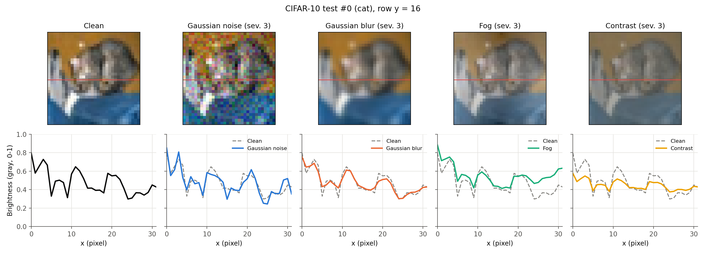
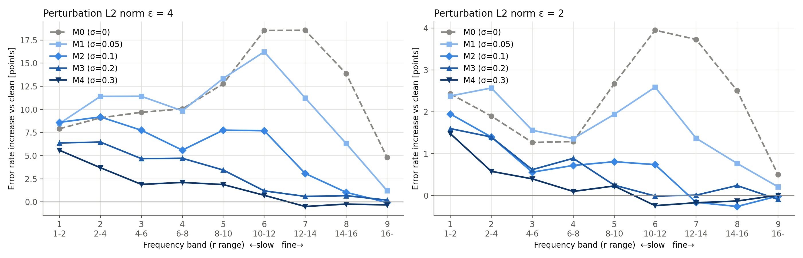
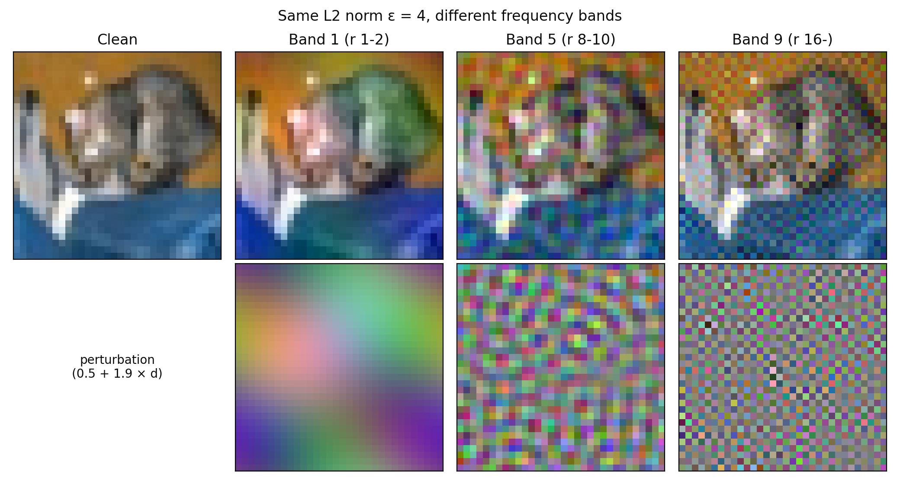

# 自由課題: ノイズを足すデータ拡張の強さと、壊れ方ごとのトレードオフ

## 目次

1. [概要](#1-概要)
2. [実行環境](#2-実行環境)
3. [ファイル構成](#3-ファイル構成)
4. [データの準備](#4-データの準備)
5. [実行手順](#5-実行手順)
6. [実験条件](#6-実験条件)
7. [結果](#7-結果)
8. [周波数の分析の方法](#8-周波数の分析の方法)
9. [注意・限界](#9-注意限界)
10. [参考文献](#10-参考文献)

---

## 1. 概要

学習画像にガウスノイズを足すデータ拡張には、次のトレードオフがあると報告されている [1][2]。
- ノイズやぼかしには強くなる
- 霧やコントラスト低下には弱くなる

この実験では、day3（第4章）の小さな CNN（`CifarCNN`）を本物の CIFAR-10 [3] で学習し、2つの問いを調べた。

- **問い1（追試）**: 論文で報告されたトレードオフが、小さな CNN でも起きるか。
- **問い2（独自）**: ノイズ拡張の最大の強さ σ を 0〜0.3 の5段階に変えると、得と損はどう変わるか。論文 [2] は CIFAR-10 で σ = 0.1 に固定している。

壊れた画像への強さは CIFAR-10-C [4] の5種類（ガウスノイズ、ガウスぼかし、霧、コントラスト低下、明るさ）で測った。

さらに、周波数帯だけを変えた「同じ大きさの邪魔」をテスト画像に足し、どの細かさの縞に敏感かが σ とともにどう変わるかを調べた（8章）。

---

## 2. 実行環境

### 学習・評価に使った環境

| 項目 | 内容 |
|---|---|
| マシン | Azure VM、Tesla T4（16GB）、Ubuntu |
| Python | 3.12 |
| PyTorch | 2.9.1+cu126（torchvision 0.24.1+cu126） |
| そのほか | numpy 2.5.4、matplotlib 3.10.8 |

### 実行時間（T4、`-g 0`）

| 処理 | 時間 |
|---|---|
| 学習 M0（σ = 0、100 エポック） | 約8分半 |
| 学習 M1〜M4（σ > 0、100 エポック） | 各約15分 |
| 評価 `eval_cifar10c.py`（1モデル） | 約10〜40秒 |
| 周波数の分析 `freq_bands.py`（5モデル、ε = 4 と 2） | 約45秒 |

- M1〜M4 が M0 より遅いのは、ノイズの乱数を CPU で作っているためである。
- GPU がなくても `-g -1` で CPU 実行できるが、時間がかかる。

### 動作確認に使った環境（小さい設定のみ）

macOS 15.5（Apple Silicon、arm64）、Python 3.12.16、torch 2.9.1、torchvision 0.24.1、numpy 2.5.4、matplotlib 3.10.8（CPU）

### ライブラリのインストール

```bash
python -m pip install torch==2.9.1 torchvision==0.24.1 numpy==2.5.4 matplotlib==3.10.8
```

GPU を使う場合は、CUDA に合った torch を入れる。学習に使った VM では `torch==2.9.1+cu126` である。

---

## 3. ファイル構成

```
free_task/
├── README.md              この文書
├── PLAN.md                実験の計画書（決めた経緯の記録）
├── download_data.sh       CIFAR-10 と CIFAR-10-C を data/ に取得する
├── network.py             CifarCNN の定義（day3_cv/network.py のコピー）
├── noise.py               学習時にバッチにガウスノイズを足す関数
├── train_noise.py         ノイズ拡張つきの学習（day3_cv/train_cifar10.py をもとに作成）
├── eval_cifar10c.py       元画像と CIFAR-10-C での誤り率を CSV に出す
├── plot_results.py        評価 CSV から図 3 枚を描く
├── plot_waveform.py       1 行の波形の図を描く
├── freq_bands.py          周波数帯ごとの敏感さの分析（8 章）
├── make_fake_cifar10c.py  動作確認用の偽の CIFAR-10-C を作る
├── figures/               この README に載せた図（result/figures/ のコピー）
├── results/               この README の数値の元の CSV（result/ のコピー）
├── data/                  データセット（Git に入れない）
└── result/                実行時の出力先（学習済みモデルなど。Git に入れない）
```

- `figures/` と `results/` は、提出用に `result/` からコピーしたものである。スクリプトはすべて `result/` に出力する。
- 学習済みモデル（`result/noise_sNNN/model_XXX.pth`）とデータセットは、サイズが大きいため Git に入れていない。

---

## 4. データの準備

以下のコマンドは、すべて `free_task/` で実行する。

```bash
cd free_task
bash download_data.sh                        # Python は環境変数 PYTHON で変えられる（既定: python）
# 例: PYTHON=../.venv/bin/python bash download_data.sh
```

`download_data.sh` は次の処理をする。すでに取得済みのデータは飛ばすので、何度実行してもよい。

1. **CIFAR-10** [3] を `torchvision.datasets.CIFAR10(download=True)` で `data/cifar-10-batches-py/` に取得する（約170MB）。
2. **CIFAR-10-C** [4] を取得する。
   - `https://zenodo.org/record/2535967/files/CIFAR-10-C.tar`（約2.9GB）を `curl` でダウンロードする。
   - 使う6ファイル（`gaussian_noise`、`gaussian_blur`、`fog`、`contrast`、`brightness`、`labels` の `.npy`）だけを `data/CIFAR-10-C/` に展開する。各約150MB である。
   - 展開が終わったら、tar は削除する。

CIFAR-10-C の各 `.npy` は 50,000×32×32×3（uint8）である。1〜10,000 枚目が強さ1、…、40,001〜50,000 枚目が強さ5 で、どの強さも CIFAR-10 テスト画像と同じ順番に並んでいる。`labels.npy` は全ファイルで共通である。

---

## 5. 実行手順

以下のコマンドは、すべて `free_task/` で実行する。GPU を使う場合は `-g 0`、CPU で実行する場合は `-g -1` を指定する。

### 5.1 学習（M0〜M4）

```bash
python -u train_noise.py -g 0 --noise-sigma 0    -e 100 --seed 0 -o result/noise_s000   # M0
python -u train_noise.py -g 0 --noise-sigma 0.05 -e 100 --seed 0 -o result/noise_s005   # M1
python -u train_noise.py -g 0 --noise-sigma 0.1  -e 100 --seed 0 -o result/noise_s010   # M2
python -u train_noise.py -g 0 --noise-sigma 0.2  -e 100 --seed 0 -o result/noise_s020   # M3
python -u train_noise.py -g 0 --noise-sigma 0.3  -e 100 --seed 0 -o result/noise_s030   # M4
```

- 出力フォルダ名の `NNN` は σ × 100 である。後の `eval_cifar10c.py`、`plot_results.py`、`freq_bands.py` は、この名前から σ を読み取る。

出力先は `result/noise_sNNN/` である。

| ファイル | 内容 |
|---|---|
| `train_log.csv` | エポックごとの学習損失・学習精度・検証精度・秒数 |
| `accuracy.png` | 学習曲線 |
| `model_001.pth` 〜 `model_100.pth` | 毎エポックのモデル |
| `best_epoch.txt` | 検証精度が最大だったエポック |
| `noise_examples.png` | ノイズの強さを目で確かめるための画像 |

### 5.2 評価（元画像と CIFAR-10-C）

```bash
for d in noise_s000 noise_s005 noise_s010 noise_s020 noise_s030; do
  python -u eval_cifar10c.py -g 0 -m result/$d
done
```

- `-m` に結果フォルダを渡すと、`best_epoch.txt` に書かれたエポックのモデルを使う。
- 結果は `result/eval_noise_sNNN.csv` に保存される。列は `corruption, severity, error` で、`error` は誤り率（%）である。元画像は `severity = 0` の行、強さ1〜5の平均は `severity = mean` の行である。
- 実行中に `labels.npy matches CIFAR-10 test labels (severity 1-5): [True, True, True, True, True]` と表示されれば、CIFAR-10-C のラベルの順番が CIFAR-10 テスト画像と一致している。

### 5.3 図（7章の図）

```bash
python plot_results.py            # result/eval_noise_s*.csv -> result/figures/ に図 3 枚
python plot_waveform.py           # テスト画像 0 番、強さ 3 -> result/figures/waveform_i0_s3.png
python -u freq_bands.py -g 0 --eps 4 2   # 8 章の分析 -> result/freq_bands_*.csv と図 2 枚
```

- `plot_waveform.py` は、`--index`（画像の番号）、`--severity`（強さ）、`--row`（描く行）を変えられる。
- `freq_bands.py` は、`--models` を省略すると `result/noise_sNNN` のうち `best_epoch.txt` があるものを全部使う。

### 5.4 小さい設定での動作確認（CPU、数分）

GPU や CIFAR-10-C がなくても、次のコマンドで全スクリプトが最後まで動くかを確かめられる。

- 学習データを300枚・1エポックに減らす。
- CIFAR-10-C の代わりに、CIFAR-10 テスト画像を5回並べた偽ファイルを使う。

```bash
python make_fake_cifar10c.py                                   # -> data/CIFAR-10-C-fake/
python -u train_noise.py -g -1 --noise-sigma 0.1 -e 1 --n-train 300 -o result/check_s010
python -u eval_cifar10c.py -g -1 -m result/check_s010 --c-dir data/CIFAR-10-C-fake -o result/check_eval.csv
python plot_waveform.py --c-dir data/CIFAR-10-C-fake -o result/check_waveform.png
python -u freq_bands.py -g -1 --models result/check_s010 --n-test 500 --out-dir result/check_freq
```

偽ファイルは壊れていない画像なので、`check_eval.csv` の誤り率は、どの壊れ方・強さでも元画像と同じになる。

---

## 6. 実験条件

### 6.1 データ

| 項目 | 内容 |
|---|---|
| 学習・検証 | CIFAR-10 の学習用 50,000 枚を、学習 45,000 枚と検証 5,000 枚に分ける。`random_split` の乱数は、`--seed` と関係なく常に種 0 で固定（全モデルで同じ分け方） |
| テスト | CIFAR-10 テスト 10,000 枚（元画像）と CIFAR-10-C 5種類 × 強さ1〜5（各 10,000 枚） |
| 画素値 | 0〜1（`ToTensor()` のみ。平均・標準偏差による正規化はしない）。CIFAR-10-C も 255 で割って 0〜1 にする |

### 6.2 ネットワークと学習

| 項目 | 内容 |
|---|---|
| ネットワーク | `CifarCNN(10, ch1=32, ch2=64, dropout=0.0)`：畳み込み5×5 → ReLU → 最大値プーリングを2回、最後に全結合層 |
| 損失関数 | 交差エントロピー |
| 最適化 | Adam、学習率 0.001 |
| バッチサイズ | 100 |
| エポック数 | 100（全モデル共通） |
| 全モデル共通の拡張 | 左右反転（`RandomHorizontalFlip()`）と切り抜き（`RandomCrop(32, padding=4)`）。学習データにだけかける |
| モデルの選び方 | 検証精度が最大のエポック（同じ値なら早いほう） |
| 乱数の種 | `--seed 0`。`torch.manual_seed` を使い、`cudnn.deterministic = True`、`cudnn.benchmark = False` |

### 6.3 ノイズ拡張（`noise.py`、`train_noise.py`）

学習ループの中で、DataLoader から取り出したバッチ（反転・切り抜き済み、0〜1）に次の処理をする。

1. 強さ s を、**バッチごとに1回**、0〜σ の一様分布から選ぶ。同じバッチの100枚は同じ s である。
2. 全画像の全画素・全チャンネルに、平均0・標準偏差 s の正規乱数を、それぞれ別々に足す。
3. 0〜1 に収める（`clamp`）。

補足:
- 検証データには、拡張もノイズもかけない。
- ノイズの乱数（s とノイズの値）は、ノイズ専用の乱数生成器（`torch.Generator`、種は `--seed`）から取る。これにより、σ が違っても、画像の順番と反転・切り抜きは全モデルで同じになる。

### 6.4 比較したモデル

| ID | σ | 出力フォルダ | 評価に使ったエポック |
|---|---|---|---|
| M0 | 0（ノイズ拡張なし） | `result/noise_s000` | 97 |
| M1 | 0.05 | `result/noise_s005` | 89 |
| M2 | 0.1（論文 [2] と同じ） | `result/noise_s010` | 95 |
| M3 | 0.2 | `result/noise_s020` | 91 |
| M4 | 0.3 | `result/noise_s030` | 95 |

---

## 7. 結果

数値はすべて `results/` の CSV から写している。誤り率の単位は % である。

### 7.1 壊れ方ごとの誤り率（強さ1〜5の平均）

出典: `results/eval_noise_sNNN.csv`。元画像の列は `severity = 0`、それ以外の列は `severity = mean` の行である。

| モデル | σ | 元画像 | ガウスノイズ | ガウスぼかし | 霧 | コントラスト低下 | 明るさ |
|---|---|---|---|---|---|---|---|
| M0 | 0 | 23.45 | 36.89 | 40.00 | 42.10 | 56.98 | 25.98 |
| M1 | 0.05 | 24.15 | 33.11 | 36.98 | 44.14 | 58.66 | 26.44 |
| M2 | 0.1 | 25.15 | 28.11 | 38.00 | 47.42 | 61.22 | 27.75 |
| M3 | 0.2 | 28.41 | 29.64 | 38.54 | 49.19 | 60.96 | 32.58 |
| M4 | 0.3 | 31.59 | 32.13 | 39.54 | 55.20 | 66.92 | 35.27 |

### 7.2 M0 との差（ポイント。マイナスは良くなった、プラスは悪くなった）

| モデル | σ | 元画像 | ガウスノイズ | ガウスぼかし | 霧 | コントラスト低下 | 明るさ |
|---|---|---|---|---|---|---|---|
| M1 | 0.05 | +0.70 | −3.78 | −3.02 | +2.04 | +1.68 | +0.46 |
| M2 | 0.1 | +1.70 | −8.78 | −2.00 | +5.32 | +4.24 | +1.77 |
| M3 | 0.2 | +4.96 | −7.25 | −1.46 | +7.09 | +3.98 | +6.60 |
| M4 | 0.3 | +8.14 | −4.76 | −0.46 | +13.10 | +9.94 | +9.29 |



- **問い1**: M2（論文と同じ σ = 0.1）では、ガウスノイズ（−8.78）とガウスぼかし（−2.00）が良くなった。一方、霧（+5.32）、コントラスト低下（+4.24）、元画像（+1.70）は悪くなった。論文 [1][2] と同じ向きのトレードオフが、小さな CNN でも起きた。
- **問い2**: ガウスノイズの改善は σ = 0.1 で最大（−8.78）だった。σ = 0.2 では −7.25、σ = 0.3 では −4.76 と小さくなった。一方、霧・コントラスト低下・元画像の悪化は、σ = 0.3 で最大になった（+13.10、+9.94、+8.14）。



### 7.3 強さごとの誤り率

強さ1〜5のすべての値は `results/eval_noise_sNNN.csv` にある。点線は、でたらめに答えた場合の誤り率 90% である。



### 7.4 壊れ方の例（1行の波形）

CIFAR-10 テスト画像0番について、元画像と4種類の壊れ方（強さ3）の画像を並べ、真ん中の横1行（y = 16）の明るさ（グレースケール）を描いた図である。



### 7.5 周波数帯ごとの敏感さ（8章の方法）

値は誤り率の増加（ポイント）である。帯1がいちばんゆっくりした縞、帯9がいちばん細かい縞である（帯の範囲は8章の表）。出典は `results/freq_bands_noise_sNNN.csv` の `eps = 4.0` の行である。元画像の誤り率は7.1の表と同じである。

| モデル | σ | 帯1 | 帯2 | 帯3 | 帯4 | 帯5 | 帯6 | 帯7 | 帯8 | 帯9 |
|---|---|---|---|---|---|---|---|---|---|---|
| M0 | 0 | 7.91 | 9.09 | 9.69 | 10.06 | 12.77 | 18.53 | 18.56 | 13.87 | 4.81 |
| M1 | 0.05 | 8.47 | 11.41 | 11.42 | 9.85 | 13.35 | 16.23 | 11.24 | 6.32 | 1.22 |
| M2 | 0.1 | 8.60 | 9.19 | 7.75 | 5.60 | 7.76 | 7.70 | 3.08 | 1.04 | −0.06 |
| M3 | 0.2 | 6.38 | 6.47 | 4.68 | 4.72 | 3.45 | 1.20 | 0.60 | 0.68 | 0.20 |
| M4 | 0.3 | 5.59 | 3.70 | 1.90 | 2.11 | 1.88 | 0.72 | −0.49 | −0.23 | −0.32 |



- M0 は帯6・帯7（r = 10〜14）でいちばん大きく増えた（18.53、18.56）。
- σ を上げるほど細かい帯での増加は小さくなり、M2 では帯8・帯9で 1.04、−0.06 とほぼ0になった。
- いちばんゆっくりした帯1の増加は、7.91（M0）〜5.59（M4）とあまり変わらなかった。
- **補足（ε = 2）**: ε = 2 でも同じ傾向だった（細かい帯への敏感さが σ とともに消え、ゆっくりした帯はあまり変わらない）。値は同じ CSV の `eps = 2.0` の行にある。

使った邪魔の例を下に示す。上の段は、元画像と、帯1・帯5・帯9の邪魔（ε = 4）を足した画像である。下の段は邪魔そのもので、見やすいように 0.5 を中心に拡大している。



---

## 8. 周波数の分析の方法

画素ごとの正規乱数（すべての細かさの縞を含む砂嵐）を、2次元 FFT する。縞の細かさ r = √(u² + v²)（32画素の中に縞が何本入るか）が指定した帯に入る成分だけを残して、逆 FFT する。L2 ノルムを 4 にそろえてテスト画像に足し、0〜1 に収める。

**誤り率の増加** = 邪魔を足したテスト画像 10,000 枚の誤り率 − 元のテスト画像 10,000 枚の誤り率

### 帯の分け方（9帯）

| 帯 | r の範囲 | 意味（32画素の中で縞が何本入るか） |
|---|---|---|
| 1 | 1 ≤ r < 2 | 1〜2本（いちばんゆっくり） |
| 2 | 2 ≤ r < 4 | 2〜4本 |
| 3 | 4 ≤ r < 6 | 4〜6本 |
| 4 | 6 ≤ r < 8 | 6〜8本 |
| 5 | 8 ≤ r < 10 | 8〜10本 |
| 6 | 10 ≤ r < 12 | 10〜12本 |
| 7 | 12 ≤ r < 14 | 12〜14本 |
| 8 | 14 ≤ r < 16 | 14〜16本（約2画素ごと） |
| 9 | 16 ≤ r | 斜め方向のいちばん細かい縞（r の最大は約22.6） |

### 実装の詳細（`freq_bands.py`）

- **u, v の範囲**: `fftfreq(32) × 32` で −16〜15 の整数である。r = 0（画像全体の平均の明るさ）は、どの帯にも入れていない。
- **FFT のかけ方**: 正規乱数は画像と同じ形（3×32×32）で作り、FFT はチャンネルごとにかける。
- **大きさのそろえ方**: L2 ノルムは、1枚ごとに3チャンネル全部（3,072個の値）で計算し、ちょうど ε にそろえてから画像に足す。0〜1 に収める処理（`clamp`）は、足したあとにかける。
- **全モデルに同じ邪魔**: 邪魔の乱数の種は、帯 b ごとに `seed × 1000 + b`（`--seed 0`）である。帯ごとに作った同じ邪魔を、全モデルに入れている。
- **ε の値**: ε = 4（必須）に加えて、ε = 2 でも測った（7.5の補足）。
- **実行中の確認**: 帯ごとの最初のバッチについて、L2 ノルムが ε であることと、FFT の二乗和のうち帯の中にある割合を表示する。今回の実行では、全帯で L2 ノルムが 4.0000（ε = 2 では 2.0000）、帯の中の割合が 1.0000 だった。

---

## 9. 注意・限界

- **乱数の種は 0 の1つだけ**である。種を変えた繰り返しはしていないので、1〜2ポイント程度の差は、種を変えると入れ替わる可能性がある。
- **M5（ノイズとぼかしを混ぜた拡張）と `defocus_blur` の評価は実施していない**。
- **再現性について**: 乱数の種を固定しているが、GPU の種類やライブラリのバージョンが違うと、結果がわずかにずれることがある。
- **天井効果**: コントラスト低下の強さ5では、誤り率が全モデルで 79.59〜81.34% だった。でたらめに答えた場合の誤り率は 90% なので、これ以上悪くなる余地が小さく、強さ5ではモデル間の差が出にくくなっている。
- **論文との違い**:
  - 論文 [2] より小さなネットワーク（`CifarCNN`、畳み込み2層）を使っている。
  - 画素値は正規化していない（0〜1 のまま）。
  - 論文 [2] は CIFAR-10 で σ = 0.1 だけを使っているが、この実験では σ を 0〜0.3 の5段階に変えている。

---

## 10. 参考文献

[1] N. Ford, J. Gilmer, N. Carlini, and E. D. Cubuk. "Adversarial Examples Are a Natural Consequence of Test Error in Noise." ICML 2019. https://arxiv.org/abs/1901.10513

[2] D. Yin, R. G. Lopes, J. Shlens, E. D. Cubuk, and J. Gilmer. "A Fourier Perspective on Model Robustness in Computer Vision." NeurIPS 2019. https://arxiv.org/abs/1906.08988

[3] A. Krizhevsky. "Learning Multiple Layers of Features from Tiny Images." Technical Report, University of Toronto, 2009.（CIFAR-10）https://www.cs.toronto.edu/~kriz/cifar.html

[4] D. Hendrycks and T. Dietterich. "Benchmarking Neural Network Robustness to Common Corruptions and Perturbations." ICLR 2019. https://arxiv.org/abs/1903.12261（CIFAR-10-C: https://zenodo.org/records/2535967）
